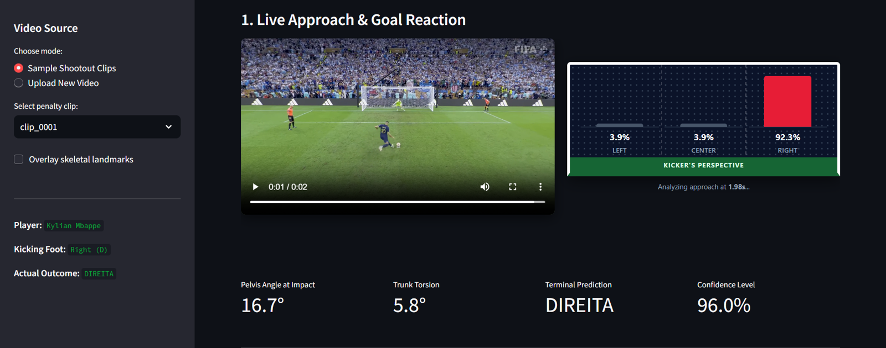

# Penalty Kick Direction Predictor (Pose-Based)

[](https://www.python.org/)
[](LICENSE)
[](https://docs.ultralytics.com/)
[](https://streamlit.io/)

Predicting football penalty kick direction (`left` / `center` / `right`, from the kicker's visual perspective) based on pre-contact body posture and biomechanics.



---

## 1. Overview and Motivation

Traditional video-based computer vision approaches often rely on heavy 3D convolutional networks over raw RGB pixel frames. These models require dedicated GPU hardware, are computationally expensive to run, and frequently suffer from shortcut learning (e.g., memorizing background features or specific player jerseys instead of physical movement).

This project employs a lightweight, interpretable biomechanical framework:

1. **Pose Estimation (YOLOv8-Pose):** Extracts temporal trajectories of 17 key anatomical joints (shoulders, pelvis, knees, ankles) frame-by-frame on standard CPU hardware.
2. **Biomechanical Feature Engineering:** Computes rotation angles of the pelvis, shoulder orientation, axial spinal torsion, stance knee flexion, and relative foot placement.
3. **Scale Invariance:** Normalizes all spatial metrics by trunk length (shoulder midpoint to hip midpoint) to account for varying camera distances, zoom levels, and broadcast perspectives.
4. **Temporal Cutoffs (Early Prediction):** Evaluates posture at progressive stages of the run-up (50%, 75%, and 100% leading up to the stance-foot ground contact) to assess when kick intent becomes physically discernible.
5. **Rigorous Player-Grouped Evaluation:** Employs player-level cross-validation (`StratifiedGroupKFold`) and benchmarks performance against a majority-class baseline to prevent overfitting to individual player styles.

---

## 2. Interactive Dashboard Features

The web dashboard (`app/app.py`) provides real-time inference and visualization:

* **Synchronized Video & Goal Reaction:** As the run-up video plays, the interactive goal graphic updates probability bars and confidence levels in real time.
* **Kicker's Perspective:** Intuitive left-center-right orientation matching the shooter's frame of reference.
* **On-the-Fly Video Upload:** Upload any penalty kick MP4 clip to automatically extract skeletal keypoints and predict direction before impact.
* **Biomechanical Metrics:** Direct readout of pelvis opening angle, trunk twist, and model confidence at stance-foot contact.

---

## 3. Biomechanical Features

The feature extractor translates raw $(x, y)$ coordinate streams into domain-relevant physical metrics:

* **Pelvis Angle:** Vector between the left and right hip joints, capturing whether the pelvis is open or closed relative to the target goal.
* **Shoulder Angle and Trunk Torsion:** Angular difference between the bi-acromial line (shoulders) and the bi-iliac line (hips), quantifying axial spinal torsion before impact.
* **Approach Run-Up Angle:** Temporal trajectory and lateral displacement of the pelvis from run-up initiation to ball contact (differentiating diagonal vs. linear approaches).
* **Angular Velocities and Dynamic Fluctuations:** Rate of change and standard deviation of pelvic and torso rotation across terminal frames.
* **Stance Leg Kinematics:** Stance knee flexion angle, kicking knee flexion, and knee flexion ratio at plant-foot ground contact.
* **Plant Foot Offsets and Spread:** Normalized horizontal (`offset_x`) and vertical (`offset_y`) distances from the plant foot to the pelvis and kicking foot, as well as plant base spread and stance lead.
* **Physical Interaction Features:** Non-linear cross-terms including kinematic momentum (approach angle x pelvis angle) and pelvis-torso coordination (pelvis angle x trunk twist).
* **Dominant Kicking Foot:** Binary indicator (Right vs. Left footed), enabling automatic identification of the supporting vs. kicking leg.

---

## 4. Repository Structure

```text
penalty-direction-predictor/
├── .gitignore
├── LICENSE
├── README.md
├── requirements.txt
├── assets/
│   └── demo.png             # Dashboard preview screenshot
├── data/
│   ├── labels.csv           # Annotation metadata (clip_id, player, kicking_foot, direction)
│   ├── raw/                 # Source raw footage (excluded from version control)
│   ├── clips/               # Segmented run-up clips (excluded from version control)
│   └── processed/           # Extracted joint coordinates and feature datasets
├── src/
│   ├── __init__.py
│   ├── config.py            # Central configuration and filesystem constants
│   ├── download.py          # Video segmentation utility
│   ├── pose.py              # Pose extraction and visual skeleton verification
│   ├── features.py          # Biomechanical feature engineering and trajectory smoothing
│   └── train.py             # GroupKFold validation and multi-model benchmarking
├── tests/
│   ├── __init__.py
│   └── test_features.py     # Automated unit tests for geometry, filters, and features
├── models/
│   ├── penalty_model.joblib # Winning trained classifier (e.g., Gradient Boosting)
│   ├── scaler.joblib        # Fitted StandardScaler
│   ├── label_encoder.joblib # Direction class label encoder
│   ├── feature_names.joblib # Feature schema
│   └── winner_name.joblib   # Top model identifier badge
└── app/
    └── app.py               # Interactive Streamlit dashboard
```

---

## 5. Getting Started

### Prerequisites

* Python 3.10+ (tested on Python 3.12 and 3.13)
* FFmpeg installed and available in the system PATH

### Installation

Clone the repository and set up a virtual environment:

```bash
git clone https://github.com/PedroA35/penalty-direction-predictor.git
cd penalty-direction-predictor

python -m venv .venv
source .venv/Scripts/activate  # On Linux/macOS: source .venv/bin/activate
pip install -r requirements.txt
```

### Quick Task Commands (Makefile & Python Runner)

The project provides modular CLI targets via `Makefile` (or cross-platform `python run.py`):

| Task | Make Command | Python CLI Alternative | Description |
| :--- | :--- | :--- | :--- |
| **Train Models** | `make train` | `python run.py train` | Run cross-validation benchmark and export top model |
| **Run Tests** | `make test` | `python run.py test` | Run automated pytest test suite |
| **Launch App** | `make app` | `python run.py app` | Launch interactive Streamlit dashboard |
| **Extract Features** | `make features` | `python run.py features` | Compute biomechanical features & trajectory smoothing |
| **Clean Cache** | `make clean` | `python run.py clean` | Remove temporary `__pycache__` and `.pytest_cache` |
| **Complete Pipeline** | `make all` | `python run.py all` | Run features -> train -> test sequentially |

### Launch Interactive Dashboard

```bash
make app  # Or: streamlit run app/app.py
```

---

## 6. Workflow

### Step 1: Clip Annotations

Define metadata in `data/labels.csv`:

```csv
clip_id,player,kicking_foot,direction
clip_0001,Kylian Mbappe,R,left
clip_0002,Lionel Messi,L,right
```

* `clip_id`: Corresponds to the video filename in `data/clips/<clip_id>.mp4`.
* `player`: Name of the kicker.
* `kicking_foot`: `R` (Right) or `L` (Left).
* `direction`: Kick target direction (`left` / `center` / `right`).

### Step 2: Pose Extraction and Visual Validation

Place the segmented run-up clips into `data/clips/` and execute:

```bash
python src/pose.py
```

This generates:

* `data/clips/<clip_id>_annotated.mp4`: Rendered video overlaying the skeletal keypoints for manual quality control.
* `data/processed/<clip_id>_pose.csv`: Frame-by-frame joint coordinates.

### Step 3: Biomechanical Feature Engineering

```bash
python src/features.py
```

Transforms joint coordinate series into scale-normalized angles and temporal slices (50%, 75%, 100% of run-up), saving the resulting dataset to `data/processed/dataset_features.csv`.

### Step 4: Model Training and Evaluation

```bash
python src/train.py
```

Runs player-grouped cross-validation (`StratifiedGroupKFold`), benchmarks against the naive majority-class baseline, generates the lead-time accuracy curve, and saves the trained model artifacts to `models/`.

---

## 7. Experimental Benchmark and Evaluation Results

### Validation Protocol

To assess real-world generalizability and prevent identity memorization, the model is evaluated using a strict **Stratified Group K-Fold cross-validation** scheme (`StratifiedGroupKFold`, $k=5$):

* **Zero Player Leakage:** Splits are strictly partitioned by athlete identity. No player present in a test fold appears in the corresponding training set.
* **Dataset Size:** 65 annotated penalty kicks from elite European competitions (encompassing 58 unique professional players).
* **Data Augmentation (Virtual Mirroring):** Virtual horizontal flipping is applied to mirror left- and right-footed mechanics, producing an augmented dataset of 130 samples across 116 unique player groups (each player and their mirrored counterpart are strictly grouped to prevent leakage).
* **Cost-Sensitive Thresholding:** Incorporates Bayes-adjusted cost-sensitive decision boundaries to calibrate probability predictions against class imbalance without injecting false-positive noise into lateral classes.

### Multi-Model Benchmark

Five distinct classifier architectures were benchmarked under identical cross-validation folds:

| Model Candidate                          |  Mean Accuracy  | Gain vs Baseline |          Status          |
| :--------------------------------------- | :-------------: | :--------------: | :----------------------: |
| **Gradient Boosting (Stochastic)** | **71.5%** | **+29.2%** | **Champion Model** |
| Support Vector Machine (RBF)             |      63.1%      |      +20.8%      |     Strong Runner-up     |
| Random Forest (Balanced)                 |      60.0%      |      +17.7%      |        Evaluated        |
| Logistic Regression (L2)                 |      48.5%      |      +6.2%      |     Linear Baseline     |
| Majority-Class Baseline                  |      42.3%      |      +0.0%      |    Zero-Rule Baseline    |

With the introduction of Savitzky-Golay trajectory smoothing and lateral trunk tilt kinematics, **Gradient Boosting emerged as the top-performing model with 71.5% mean accuracy** (+29.2 percentage points over baseline). Removing high-frequency pixel jitter stabilized angular velocity derivatives, allowing tree-based boosting to identify decisive non-linear thresholds in dynamic pelvic rotation and trunk lean without overfitting.

### Out-of-Fold Confusion Matrix

The following confusion matrix compiles all predictions made strictly on unseen players during out-of-fold cross-validation:

```text
Actual \ Pred      CENTER      LEFT     RIGHT      Recall
---------------------------------------------------------
CENTER                 14         4         4       63.6%
LEFT                    0        40        14       74.1%
RIGHT                   1        14        39       72.2%
---------------------------------------------------------
Precision           93.3%     69.0%     68.4%
```

#### Detailed Per-Class Metrics

| Target Class               |   Precision   |     Recall     |    F1-Score    | Support |
| :------------------------- | :------------: | :------------: | :------------: | :-----: |
| **CENTER**           | **0.93** |      0.64      | **0.78** |   22   |
| **LEFT**             |      0.69      | **0.74** |      0.71      |   54   |
| **RIGHT**            |      0.68      |      0.72      |      0.70      |   54   |
| **Overall Accuracy** |                |                | **0.71** |   130   |
| **Macro Average**    | **0.77** |      0.70      | **0.73** |   130   |
| **Weighted Average** |      0.73      |      0.71      |      0.72      |   130   |

### Biomechanical Findings and Discussion

1. **Breakthrough in Central Penalty Prediction:**
   The combination of trajectory smoothing and lateral trunk tilt features unlocked a major predictive breakthrough for central penalties. Rather than being split 50/50, the model correctly identified **14 out of 22 central penalties (63.6% recall)** with an outstanding **93.3% precision** (only 1 false positive across all unseen player folds). A stabilized vertical trunk posture with reduced lateral lean serves as a definitive physical signature for central strikes.
2. **Balanced Lateral Discrimination:**
   Predictions for Left and Right shots remain tightly balanced and robust, achieving **74.1% recall** on Left shots and **72.2% recall** on Right shots on athletes unseen during training.
3. **Top Physics-Informed Predictors:**

   * **Hip Angular Velocity (`hip_angular_velocity` - 10.1%):** Rate of pelvic rotation in the final approach window is the single strongest physical differentiator.
   * **Approach Lateral Drift (`approach_lateral_drift` - 5.1%):** Lateral displacement of the kicker's center of mass relative to trunk length.
   * **Mean Terminal Lateral Tilt (`abs_lateral_trunk_tilt_mean_end` - 4.7%):** Magnitude of trunk lean away from the vertical axis prior to impact.
   * **Tilt-Pelvis Interaction (`tilt_pelvis_interaction` - 4.6%):** Kinetic coupling between coronal trunk inclination and transversal pelvic rotation.
   * **Terminal Knee Distance (`knee_distance_last` - 4.1%):** Inter-knee base spread at plant foot touchdown.

---

## 8. Limitations and Future Directions

* **Broadcast Camera Angles:** Television broadcast feeds vary between high tactical angles, ground-level views, and oblique perspectives. Future iterations will incorporate homography estimation to project body keypoints onto a normalized pitch coordinate plane.
* **Dataset Scaling:** While 65 annotated clips (130 augmented samples) establish statistically significant separation over the baseline, collecting 200+ penalty instances will further improve minority-class calibration (specifically center shots).
* **Multi-Modal Goalkeeper Interaction:** Future work can analyze simultaneous goalkeeper posturing to model kicker-goalkeeper game theory dynamics.

---

## 9. Academic References & Related Works

1. **Lees, A., & Nolan, L. (1998).** *The biomechanics of soccer: A review.* Journal of Sports Sciences, 16(3), 211-234.
2. **Savelsbergh, G. J., et al. (2002).** *Visual search, anticipation and expertise in soccer goalkeepers.* Journal of Sports Sciences, 20(3), 279-287.
3. **Jocher, G., Chaurasia, A., & Qiu, J. (2023).** *Ultralytics YOLOv8-Pose (Version 8.0.0).* GitHub repository.
