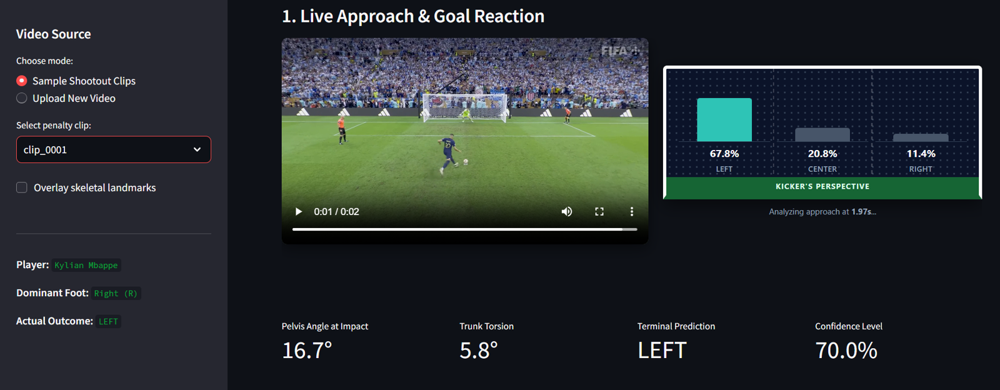

# Penalty Kick Direction Predictor (Pose-Based)

[](https://www.python.org/)
[](LICENSE)
[](https://docs.ultralytics.com/)
[](https://streamlit.io/)

Predicting football penalty kick direction (`left` / `center` / `right`, from the kicker's visual perspective) based on pre-contact body posture and biomechanics.



---

## 1. Overview and Motivation

Traditional video-based computer vision approaches often rely on heavy 3D convolutional networks over raw RGB pixel frames. These models require dedicated GPU hardware, are computationally expensive to run, and frequently suffer from shortcut learning (e.g., memorizing background features or specific player jerseys instead of physical movement).

This project employs a lightweight, interpretable biomechanical framework:

1. **Pose Estimation (YOLOv8-Pose):** Extracts temporal trajectories of 17 key anatomical joints (shoulders, pelvis, knees, ankles) frame-by-frame on standard CPU hardware.
2. **Biomechanical Feature Engineering:** Computes rotation angles of the pelvis, shoulder orientation, axial spinal torsion, stance knee flexion, and relative foot placement.
3. **Scale Invariance:** Normalizes all spatial metrics by trunk length (shoulder midpoint to hip midpoint) to account for varying camera distances, zoom levels, and broadcast perspectives.
4. **Temporal Cutoffs (Early Prediction):** Evaluates posture at progressive stages of the run-up (50%, 75%, and 100% leading up to the stance-foot ground contact) to assess when kick intent becomes physically discernible.
5. **Rigorous Player-Grouped Evaluation:** Employs player-level cross-validation (`StratifiedGroupKFold`) and benchmarks performance against a majority-class baseline to prevent overfitting to individual player styles.

---

## 2. Interactive Dashboard Features

The web dashboard (`app/app.py`) provides real-time inference and visualization:

* **Synchronized Video & Goal Reaction:** As the run-up video plays, the interactive goal graphic updates probability bars and confidence levels in real time.
* **Kicker's Perspective:** Intuitive left-center-right orientation matching the shooter's frame of reference.
* **On-the-Fly Video Upload:** Upload any penalty kick MP4 clip to automatically extract skeletal keypoints and predict direction before impact.
* **Biomechanical Metrics:** Direct readout of pelvis opening angle, trunk twist, and model confidence at stance-foot contact.

---

## 3. Biomechanical Features

The feature extractor translates raw $(x, y)$ coordinate streams into domain-relevant physical metrics:

* **Pelvis Angle:** The vector between the left and right hip joints indicates whether the pelvis is open or closed relative to the goal.
* **Shoulder Angle and Trunk Torsion:** The angular difference between the shoulder line and hip line captures rotational torso torque prior to ball impact.
* **Approach Run-Up Angle:** Measures the angular trajectory and lateral drift of the pelvis from approach onset to ball contact (e.g. wide diagonal arc vs. linear approach).
* **Angular Velocities:** Rate of change of pelvis and torso rotation across the terminal frames.
* **Stance Knee Flexion:** Angle between hip, knee, and ankle of the supporting leg at ground contact.
* **Normalized Foot Coordinates:** Relative horizontal and vertical offset between the support foot and the pelvic center, divided by trunk length.
* **Dominant Kicking Foot:** Binary indicator (`R` for right, `L` for left).

---

## 4. Repository Structure

```text
penalty-direction-predictor/
├── .gitignore
├── LICENSE
├── README.md
├── requirements.txt
├── assets/
│   └── demo.png             # Dashboard preview screenshot
├── data/
│   ├── labels.csv           # Annotation metadata (clip_id, player, kicking_foot, direction)
│   ├── raw/                 # Source raw footage (excluded from version control)
│   ├── clips/               # Segmented run-up clips (excluded from version control)
│   └── processed/           # Extracted joint coordinates and feature datasets
├── src/
│   ├── __init__.py
│   ├── download.py          # Video segmentation utility
│   ├── pose.py              # Pose extraction and visual skeleton verification
│   ├── features.py          # Biomechanical feature engineering and temporal slicing
│   └── train.py             # GroupKFold validation and model training
└── app/
    └── app.py               # Interactive Streamlit dashboard
```

---

## 5. Getting Started

### Prerequisites

* Python 3.10+ (tested on Python 3.12 and 3.13)
* FFmpeg installed and available in the system PATH

### Installation

Clone the repository and set up a virtual environment:

```bash
git clone https://github.com/PedroA35/penalty-direction-predictor.git
cd penalty-direction-predictor

python -m venv .venv
source .venv/Scripts/activate  # On Linux/macOS: source .venv/bin/activate
pip install -r requirements.txt
```

### Launch Interactive Dashboard

```bash
streamlit run app/app.py
```

---

## 6. Workflow

### Step 1: Clip Annotations

Define metadata in `data/labels.csv`:

```csv
clip_id,player,kicking_foot,direction
clip_0001,Kylian Mbappe,R,left
clip_0002,Lionel Messi,L,right
```

* `clip_id`: Corresponds to the video filename in `data/clips/<clip_id>.mp4`.
* `player`: Name of the kicker.
* `kicking_foot`: `R` (Right) or `L` (Left).
* `direction`: Kick target direction (`left` / `center` / `right`).

### Step 2: Pose Extraction and Visual Validation

Place the segmented run-up clips into `data/clips/` and execute:

```bash
python src/pose.py
```

This generates:

* `data/clips/<clip_id>_annotated.mp4`: Rendered video overlaying the skeletal keypoints for manual quality control.
* `data/processed/<clip_id>_pose.csv`: Frame-by-frame joint coordinates.

### Step 3: Biomechanical Feature Engineering

```bash
python src/features.py
```

Transforms joint coordinate series into scale-normalized angles and temporal slices (50%, 75%, 100% of run-up), saving the resulting dataset to `data/processed/dataset_features.csv`.

### Step 4: Model Training and Evaluation

```bash
python src/train.py
```

Runs player-grouped cross-validation (`StratifiedGroupKFold`), benchmarks against the naive majority-class baseline, generates the lead-time accuracy curve, and saves the trained model artifacts to `models/`.

---

## 7. Evaluation Methodology and Limitations

* **Player Leakage Prevention:** Standard random splits produce artificially inflated scores because a model can memorize a player's individual running signature. By evaluating exclusively with `GroupKFold` grouped by player, all evaluation folds test on athletes unseen during training.
* **Baseline Comparison:** In small or unbalanced datasets (such as penalty shootouts where goalkeepers or takers favor one side), a trivial model predicting the majority class can achieve deceptive accuracy. Comparing model performance directly against this baseline is mandatory.
* **Sample Size Considerations:** Initial prototype results on small datasets serve primarily to validate feature quality and tracking stability. Ongoing work focuses on expanding the dataset to 300+ penalty instances across multiple competitions to improve generalization across varied kicking styles.

---

## 8. Academic References & Related Works

1. **Lees, A., & Nolan, L. (1998).** *The biomechanics of soccer: A review.* Journal of Sports Sciences, 16(3), 211-234.
2. **Savelsbergh, G. J., et al. (2002).** *Visual search, anticipation and expertise in soccer goalkeepers.* Journal of Sports Sciences, 20(3), 279-287.
3. **Jocher, G., Chaurasia, A., & Qiu, J. (2023).** *Ultralytics YOLOv8-Pose (Version 8.0.0).* GitHub repository.
